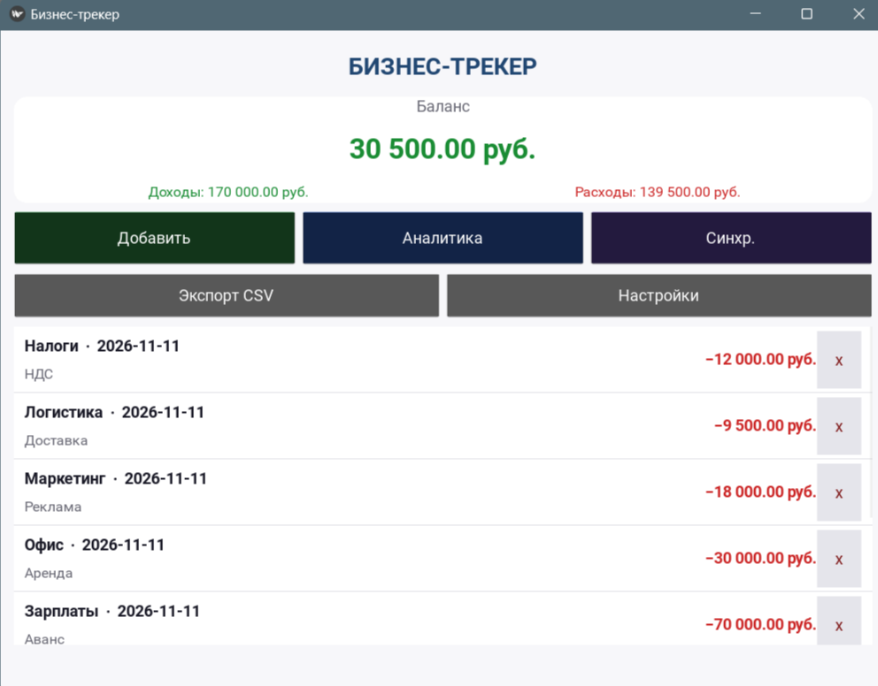
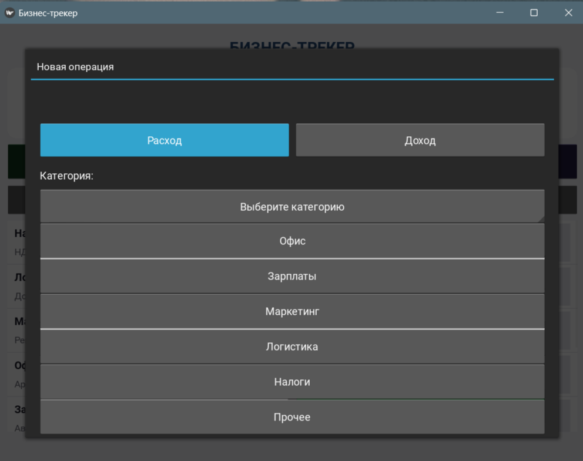
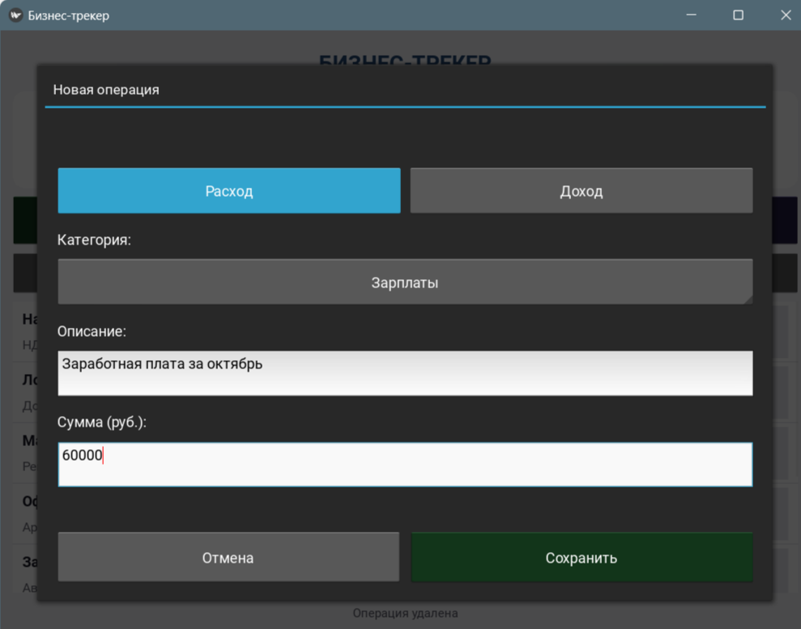
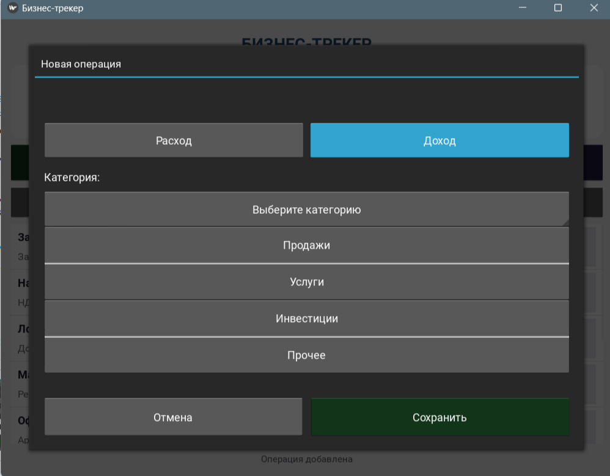
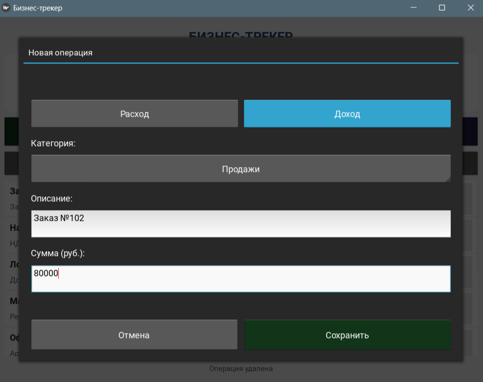
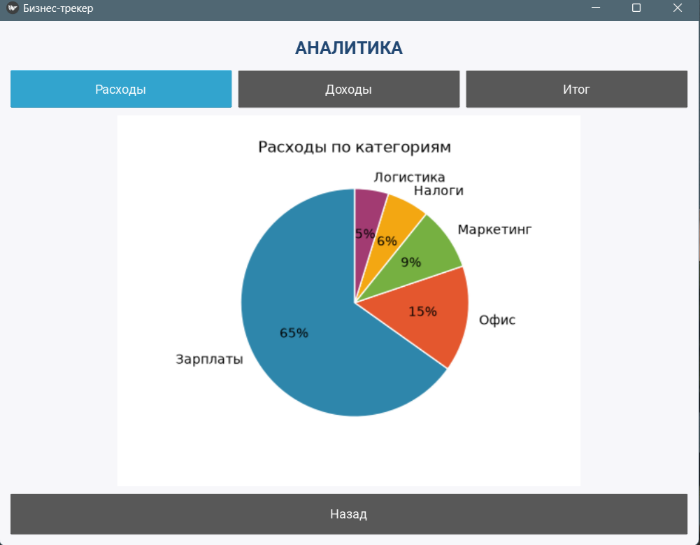
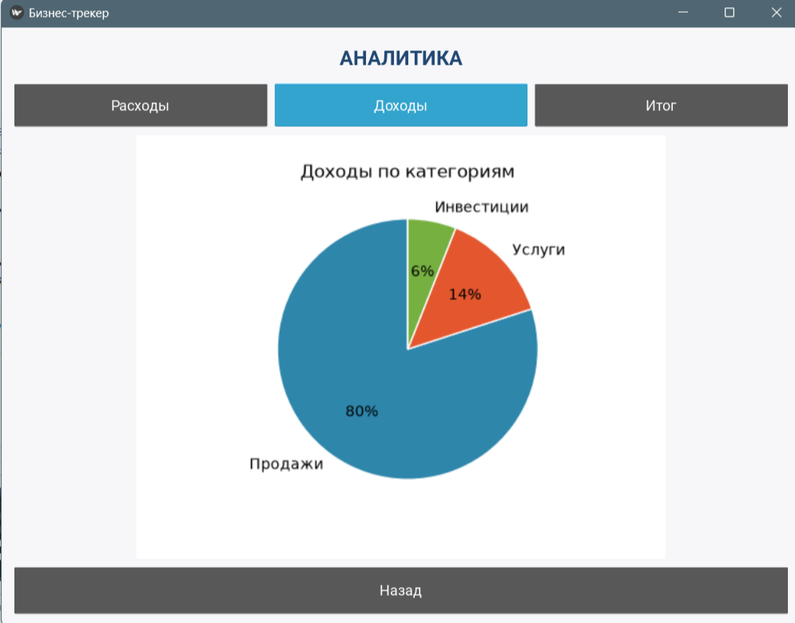
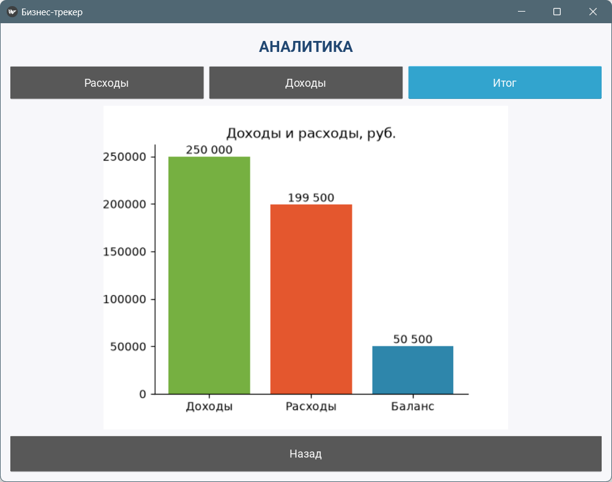
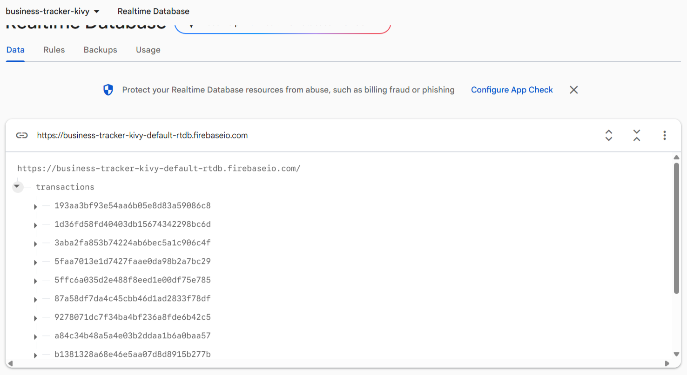
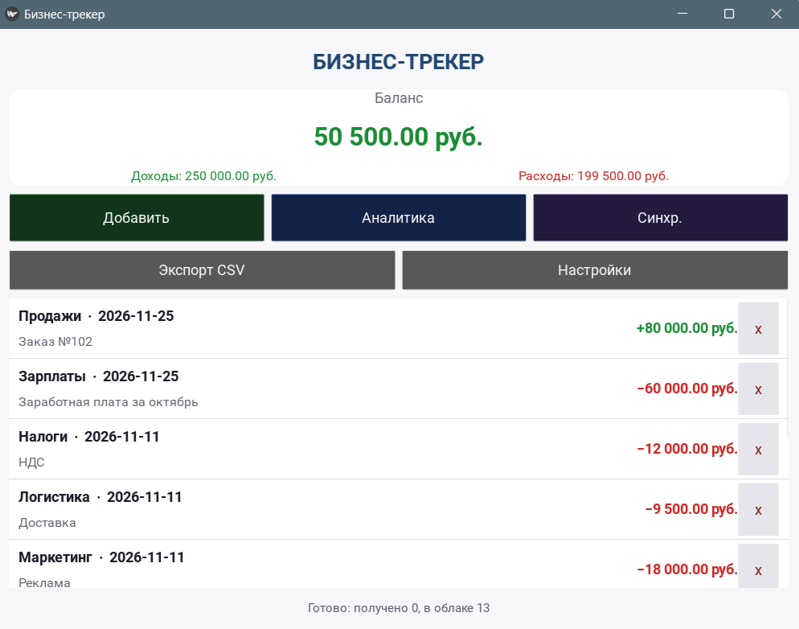

# Отчёт по домашнему заданию к лекции 6: мобильное приложение на Kivy

Тема: «Бизнес-трекер», учёт доходов и расходов малого бизнеса.
Автор: Миньковская Ксения Максимовна, группа Б1123-38.03.05ба(2).
Дисциплина: проектирование и разработка бизнес-ориентированного программного обеспечения.

## 1. Задание

По домашнему заданию к лекции 6 нужно было доработать приложение на Kivy:

1. добавить графики на Matplotlib (Kivy Garden);
2. реализовать синхронизацию с облаком через REST API (Firebase);
3. добавить категории доходов и баланс.

Ниже описано, как каждый пункт был выполнен, со скриншотами работающего приложения.

## 2. Состав проекта

| Файл | Назначение |
|---|---|
| main.py | запуск приложения, экраны, обработка кнопок |
| tracker.kv | описание интерфейса на языке Kv |
| models.py | модель данных: операции, категории, баланс, экспорт в CSV, слияние с облаком |
| charts.py | построение графиков Matplotlib |
| cloud.py | синхронизация с Firebase Realtime Database по REST API |
| tests/test_logic.py | проверка логики без интерфейса |
| buildozer.spec | настройки сборки под Android |
| requirements.txt | зависимости |

Логика данных (models.py) не зависит от Kivy, поэтому её можно проверять отдельно от интерфейса. Интерфейс только вызывает методы модели и показывает результат.

## 3. Ход работы

### Этап 1. Главный экран и баланс

На главном экране сверху показан итоговый баланс, под ним суммы доходов и расходов. Ниже кнопки «Добавить», «Аналитика», «Синхр.», «Экспорт CSV» и «Настройки», а под ними список операций с категорией, датой, описанием и суммой. Расходы выделены красным цветом со знаком минус, доходы зелёным. Справа у каждой операции кнопка удаления.

Баланс считается как разность доходов и расходов по всем неудалённым операциям. На рисунке 1 доходы составляют 170 000 руб., расходы 139 500 руб., баланс 30 500 руб.



Рисунок 1. Главный экран с балансом и списком операций

Как видно из рисунка 1, на главном экране сразу отображаются баланс, суммы доходов и расходов и список последних операций. Расходы выделены красным цветом со знаком минус, доходы зелёным, поэтому тип операции понятен без чтения подписи.

### Этап 2. Категории расходов и доходов

Кнопка «Добавить» открывает окно «Новая операция». Вверху переключатель между расходом и доходом, ниже выбор категории, описание и сумма. Набор категорий зависит от типа операции.

Для расходов предусмотрены категории: Офис, Зарплаты, Маркетинг, Логистика, Налоги, Прочее (рисунок 2). Для доходов: Продажи, Услуги, Инвестиции, Прочее (рисунок 4).



Рисунок 2. Выбор категории расхода

Как видно из рисунка 2, для расходов предусмотрены шесть категорий: Офис, Зарплаты, Маркетинг, Логистика, Налоги и Прочее. Список открывается при нажатии на поле «Категория».

Для проверки добавлен расход по категории «Зарплаты» на 60 000 руб. с описанием «Заработная плата за октябрь» (рисунок 3).



Рисунок 3. Добавление расхода

На рисунке 3 в форму введены категория «Зарплаты», описание «Заработная плата за октябрь» и сумма 60 000. После нажатия кнопки «Сохранить» операция попадает в список и учитывается в расходах.



Рисунок 4. Выбор категории дохода

Как видно из рисунка 4, при переключении на «Доход» список категорий меняется: Продажи, Услуги, Инвестиции и Прочее. Внизу окна приложение сообщает «Операция добавлена».

Затем добавлен доход по категории «Продажи» на 80 000 руб. с описанием «Заказ №102» (рисунок 5).



Рисунок 5. Добавление дохода

На рисунке 5 показано добавление дохода по категории «Продажи» с описанием «Заказ №102» на сумму 80 000 руб.

Перед сохранением приложение проверяет данные: тип операции должен быть известен, категория выбрана, сумма должна быть числом больше нуля. При ошибке внизу окна появляется сообщение.

После добавления двух операций баланс пересчитался: 30 500 + 80 000 − 60 000 = 50 500 руб. (рисунок 8 ниже и рисунок 10).

### Этап 3. Графики Matplotlib

Кнопка «Аналитика» открывает экран с тремя вкладками. Графики строятся на Matplotlib и встраиваются в интерфейс Kivy.

Вкладка «Расходы» показывает круговую диаграмму расходов по категориям (рисунок 6). Самая крупная доля у зарплат, 65 %, затем офис 15 %, маркетинг 9 %, налоги 6 % и логистика 5 %.



Рисунок 6. Расходы по категориям

Как видно из рисунка 6, наибольшую долю расходов занимают зарплаты, 65 %. Далее идут офис (15 %), маркетинг (9 %), налоги (6 %) и логистика (5 %).
Вкладка «Доходы» показывает структуру доходов (рисунок 7): продажи 80 %, услуги 14 %, инвестиции 6 %.



Рисунок 7. Доходы по категориям

На рисунке 7 видно, что основной источник дохода это продажи, 80 %. Услуги дают 14 %, инвестиции 6 %.
Вкладка «Итог» сравнивает доходы, расходы и баланс столбчатой диаграммой (рисунок 8): доходы 250 000 руб., расходы 199 500 руб., баланс 50 500 руб.



Рисунок 8. Доходы, расходы и баланс

Как видно из рисунка 8, доходы составили 250 000 руб., расходы 199 500 руб., баланс 50 500 руб. Эти значения совпадают с данными на главном экране.
Если операций нет, вместо графика выводится надпись «Нет данных». Графики строятся при каждом открытии экрана, поэтому всегда отражают текущие данные.

### Этап 4. Синхронизация с Firebase

Для облачного хранения создана база Firebase Realtime Database. Адрес базы вводится на экране «Настройки», в коде он не хранится. Операции лежат в узле `/transactions`.

Кнопка «Синхр.» запускает обмен данными по REST API в отдельном потоке, чтобы интерфейс не зависал:

1. приложение запрашивает из облака все операции (запрос GET на `/transactions.json`);
2. локальные данные объединяются с облачными: при совпадении идентификаторов побеждает запись с более поздним временем изменения;
3. полный набор операций отправляется обратно в облако (запрос PUT).

Удаление тоже синхронизируется: удалённая операция не стирается сразу, а помечается, чтобы пометка дошла до облака и другого устройства. Благодаря этому приложение можно использовать на нескольких устройствах с одной базой.

На рисунке 9 показана консоль Firebase: приложение создало узел `transactions`, внутри которого каждая операция хранится под своим уникальным идентификатором. Рисунок 10 показывает главный экран после синхронизации: внизу сообщение «Готово: получено 0, в облаке 13». Это значит, что новых записей из облака не пришло, а в облаке теперь хранится 13 операций.



Рисунок 9. Узел transactions в Firebase Realtime Database с загруженными операциями

Как видно из рисунка 9, после синхронизации в базе Firebase появился узел transactions. Каждая операция хранится в нём под собственным идентификатором.



Рисунок 10. Главный экран после синхронизации

На рисунке 10 внизу экрана выведено сообщение «Готово: получено 0, в облаке 13». Это означает, что синхронизация прошла успешно: все 13 операций загружены в облако, новых записей из облака не пришло.

### Этап 5. Дополнительные возможности

Кнопка «Экспорт CSV» сохраняет операции в файл с разделителем «;» и кодировкой UTF-8 с BOM, такой файл корректно открывается в Excel. В «Настройках» есть кнопка «Добавить демо-данные» для быстрого показа работы приложения.

## 4. Запуск

```
pip install -r requirements.txt
python main.py
```

Проверка логики без интерфейса:

```
python -m unittest discover -s tests -v
```

Сборка под Android выполняется командой `buildozer android debug` по настройкам из `buildozer.spec`.

## 5. Вывод

В приложение добавлены три функции из задания: графики Matplotlib, синхронизация с Firebase по REST API и категории доходов и расходов с балансом. Приложение запускается, добавляет и удаляет операции, пересчитывает баланс, строит три вида графиков и обменивается данными с облачной базой. Логика данных вынесена в отдельный модуль и покрыта тестами, а интерфейс и облако подключены к ней через простые вызовы.
